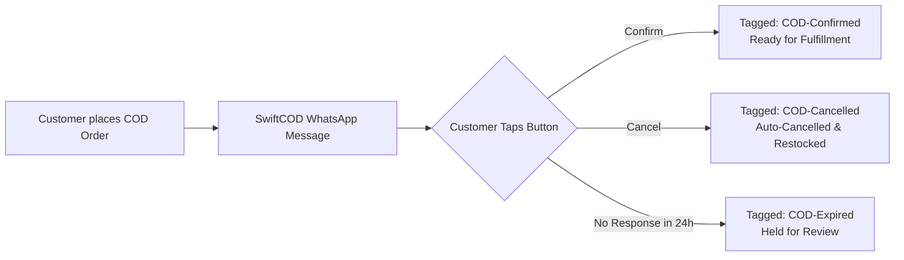

# Shopify App Store Listing Copy & Metadata

This document contains the complete, conversion-optimized, and SEO-crafted marketing package for the **Shopify App Store** listing submission.

---

## 1. App Title & Subtitle Specifications

### Primary App Name (27 characters / Limit: 30)
```text
SwiftCOD: WhatsApp Verify
```

#### Alternative Approved Names:
- `VerifyCOD: WhatsApp Verify` (27 characters)
- `QuickCOD: WhatsApp Order Verify` (30 characters)

---

### App Tagline / Headline (58 characters / Limit: 60)
```text
Stop fake COD orders & cut RTO with 1-click WhatsApp verify
```

#### Alternative Approved Taglines:
- `1-Click WhatsApp COD confirmation. Auto-cancel fake orders.` (59 characters)
- `Reduce RTO losses with automated WhatsApp order verification.` (59 characters)

---

## 2. Key Benefit Bullet Points (Shopify Store Front Highlights)

* **Instant 1-Click WhatsApp Verification:** Automatically triggers interactive WhatsApp messages with native **[Confirm Order]** and **[Cancel Order]** buttons seconds after checkout.
* **Drastic RTO & Courier Loss Reduction:** Eliminates courier non-delivery charges by identifying fake addresses and impulse orders before dispatch.
* **Auto-Cancel & Restock Automation:** Automatically cancels rejected or unverified orders in Shopify and instantly restocks inventory.
* **Zero-Config SaaS Convenience:** No complex Meta Developer setups or API keys required from merchants; works right out of the box.
* **Real-Time Admin Tagging:** Instantly applies `COD-Confirmed`, `COD-Cancelled`, or `COD-Expired` tags to streamline fulfillment workflows.
* **Live Loss-Saved Financial Analytics:** View real-time metrics showing total money saved from intercepted fake deliveries and prevented RTO fees.
* **Smart International Phone Sanitization:** Automatically sanitizes and standardizes phone numbers into E.164 format across Pakistan, India, GCC, and 190+ countries.

---

## 3. Detailed App Description (Store Listing Body)

### The Problem: The High Cost of Cash on Delivery (COD)
Cash on Delivery is the lifeblood of e-commerce across emerging markets, but it comes with a devastating penalty: **Return to Origin (RTO)**. 

When customers enter fake phone numbers, place impulse orders they later refuse, or change their minds before delivery, merchants pay full courier shipping and return penalty fees—often **$3 to $8 (PKR 450 - PKR 1,200 / ₹300 - ₹600) per rejected parcel**. Manual verification call centers are slow, expensive, and result in delayed dispatches that anger legitimate customers.

---

### The Solution: SwiftCOD Automated WhatsApp Verification
**SwiftCOD** replaces manual call centers with an automated, high-converting WhatsApp verification system. 

Within seconds of a customer placing a Cash on Delivery order, SwiftCOD delivers an official, interactive WhatsApp verification message directly to their smartphone. With **one tap**, the customer verifies their order or cancels it without typing a single word.

---

### How SwiftCOD Works:



1. **Instant Checkout Trigger:** As soon as an order with a manual/COD payment method is created, SwiftCOD ingests the order details and formats the customer's phone number into valid international E.164 format.
2. **Interactive Quick-Reply Message:** The customer receives a branded WhatsApp notification with order details, item names, and total amount, paired with two high-contrast quick-reply buttons:
   - **🟢 Confirm Order**
   - **🔴 Cancel Order**
3. **Automated State Machine Execution:**
   - **When Confirmed:** The order is instantly stamped with `COD-Confirmed` in Shopify admin. Your fulfillment warehouse knows it's 100% safe to pack and ship.
   - **When Cancelled:** The order is marked with `COD-Cancelled`, automatically cancelled in Shopify with restock enabled, and marked as voided.
   - **When Ignored:** If the customer does not respond within the customizable auto-expiry window (12h, 24h, or 48h), the order is tagged `COD-Expired` to prevent dispatch to unresponsive buyers.

---

### Enterprise Features Built for Serious Merchants:

* **Zero Meta API Setup Required:** Unlike developer-oriented apps that require you to configure Meta Business Manager, System Users, and webhooks, SwiftCOD runs on an enterprise SaaS platform. Install the app, toggle "Enable Automated COD Verification", and you are live.
* **Measurable ROI Dashboard:** See your exact return on investment. Our live merchant dashboard tracks intercepted fake orders and calculates the net shipping cash saved based on your store's average courier return cost.
* **Customizable Store Policies:** Configure auto-cancellation rules, order timeout thresholds, custom admin tags, and RTO cost estimates directly in Shopify Polaris admin.
* **Global Support & Multi-Country Routing:** Built-in intelligence detects local carrier formats across Pakistan (Jazz, Telenor, Zong, Ufone), India, UAE, Saudi Arabia, Egypt, Nigeria, and beyond.
* **Enterprise Security & Reliability:** Built with Shopify Remix, PostgreSQL session pooling, and official Meta Cloud API infrastructure with 99.9% uptime. Fully compliant with GDPR, CCPA, and Shopify privacy standards.

---

## 4. Search Keywords & Store Tags (Shopify App Store SEO)

1. `Cash on Delivery`
2. `COD Verification`
3. `WhatsApp Verification`
4. `RTO Reduction`
5. `Order Confirmation`
6. `WhatsApp Notification`
7. `COD Fraud Prevention`
8. `Auto Cancel Fake Orders`
9. `WhatsApp Quick Reply`
10. `Order Tagging Automation`
11. `COD OTP`
12. `Courier Return Protection`

---

## 5. Frequently Asked Questions (FAQ for Merchants)

#### Q: Do I need a Facebook Developer Account or Meta Business Manager to use SwiftCOD?
**A:** No! SwiftCOD is 100% managed. You do not need to generate Meta access tokens, create Facebook apps, or verify Meta business accounts. Everything runs seamlessly through our secure, pre-approved enterprise messaging gateway.

#### Q: What happens if a customer doesn't respond to the WhatsApp message?
**A:** You control the expiry window in settings (e.g., 24 hours). If an order remains unverified after the window expires, SwiftCOD automatically tags the order `COD-Expired` so your fulfillment team never wastes money dispatching ghost orders.

#### Q: Will this interfere with prepaid or credit card orders?
**A:** Never. SwiftCOD strictly filters for manual and Cash on Delivery payment gateways. Orders paid via Shopify Payments, Stripe, PayPal, or credit cards bypass verification and proceed directly to fulfillment.

#### Q: Does SwiftCOD restock items when an order is cancelled?
**A:** Yes. When a customer taps **Cancel Order**, SwiftCOD automatically executes Shopify's official order cancellation mutation with inventory restocking enabled, freeing up stock for paying buyers immediately.

#### Q: Is customer data secure and compliant with privacy laws?
**A:** Absolutely. SwiftCOD adheres strictly to GDPR, CCPA, and Shopify App Store compliance requirements. We maintain automated endpoints for Customer Data Request, Customer Redaction, and Store Redaction webhooks. Customer phone numbers are strictly used for transactional verification.

#### Q: How does billing and currency conversion work?
**A:** All plans are processed directly through Shopify's official AppSubscription API. While plans are priced in USD ($0 Free, $5.99 Launch Special, $14.99 Growth, $39.99 Scale), Shopify automatically converts charges into your store's native billing currency (PKR, INR, AED, SAR, GBP, EUR, etc.) on your regular monthly Shopify invoice. Paid plans feature a 7-day trial with automatic renewal via your Shopify payment method on file.
